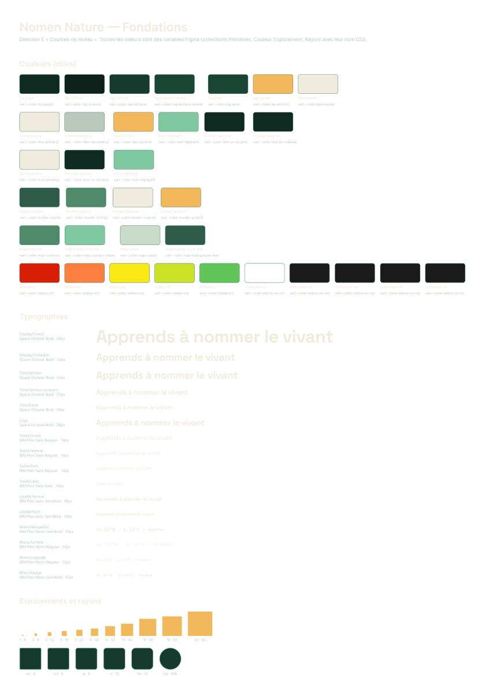

# Design system

*Étape 3 — créé le 17 novembre 2026, à partir du style retenu (direction E d'origine, « Courbes de niveau »). Fichier : [Figma « Nomen »](https://www.figma.com/design/lbR59tuBWRe62sapV6RSum/Nomen), pages **Fondations** et **Composants**.*

Tout est construit avec des **variables Figma** : changer une couleur ou un espacement à un endroit le met à jour partout. Chaque variable porte déjà le **nom CSS** qu'elle aura dans le code (par exemple `var(--color-bg-page)`).

## Fondations

### Couleurs

Deux niveaux : des **primitives** (les teintes brutes, cachées) et des **rôles** (ce qu'on utilise vraiment), qui pointent vers les primitives.

| Rôle | Valeur | Usage |
|---|---|---|
| `color/bg/page` | `#0F2A21` forêt de nuit | Fond de page |
| `color/bg/sunken` | `#0B2119` | Zones en creux (carte, barre latérale) |
| `color/bg/surface` | `#163A2E` | Cartes, panneaux, champs |
| `color/bg/surface-raised` / `land` | `#1A4434` | Photo absente, terres sur la carte |
| `color/bg/accent` | `#F2B85B` ambre | Bouton principal |
| `color/bg/inverse` | `#F1EBDD` crème | Puce sélectionnée |
| `color/text/primary` | `#F1EBDD` crème | Texte principal |
| `color/text/secondary` | `#B9C7BC` sauge | Texte secondaire, noms latins |
| `color/text/accent` | `#F2B85B` | Liens d'action, mot mis en avant |
| `color/text/highlight` | `#7FC8A0` menthe | Surtitres, coordonnées |
| `color/text/on-accent` | `#0F2A21` | Texte sur ambre |
| `color/border/subtle` / `strong` | `#2F5C4A` / `#4F8A6B` | Séparateurs, contours |
| `color/map/contour` / `contour-index` | `#4F8A6B` / `#7FC8A0` | Courbes de niveau (normales / maîtresses) |
| `color/map/coast` | `#C9DCC9` | Traits de côte |
| `color/status/cr…lc` | couleurs officielles UICN | Badges de statut (+ `on-…` pour le texte) |

Contrastes vérifiés : texte principal 12,9:1, secondaire 8,7:1, texte sur ambre 8,6:1 (niveau WCAG AA largement atteint).

### Typographies

| Style | Police | Usage |
|---|---|---|
| Display/Grand · Display/Compact | Space Grotesk Bold 58 / 34 | Titre principal (ordinateur / téléphone) |
| Titre/Section · Titre/Section compact | Space Grotesk Bold 34 / 22 | Titres de section |
| Titre/Carte | Space Grotesk Bold 18 | Nom d'espèce |
| Logo | Space Grotesk Bold 26 | Mot-symbole (provisoire) |
| Texte/Grand · Normal · Petit | IBM Plex Sans 19 / 16 / 14 | Texte courant |
| Texte/Latin | IBM Plex Sans Italic 14 | Noms scientifiques |
| Libellé/Normal · Petit | IBM Plex Sans SemiBold 16 / 14 | Boutons, puces, onglets |
| Mono/Navigation · Surtitre · Légende · Badge | IBM Plex Mono 15 / 14 / 12 / 12 | Navigation, surtitres, crédits, coordonnées, badges |

### Espacements et rayons

- Espacements : 4, 8, 12, 16, 20, 24, 32, 40, 56, 64, 80 px (`space/1` à `space/20`).
- Rayons : 4, 6, 8, 10, 14 px et « plein » (`radius/sm` à `radius/full`).

## Composants

| Composant | Variantes | Propriétés réglables |
|---|---|---|
| **Icônes** (10) | Recherche, Position, Appareil photo, Feuille, Plus, Moins, Menu, Globe, Flèche droite, Fermer | Couleur via variable |
| **Logo** | — | Provisoire, à remplacer par le vrai logo |
| **Bouton** | Style Principal / Secondaire × Taille Grand / Compact | Libellé, Icône (échangeable), Avec icône |
| **Bouton icône** | — (44 × 44 px, zone tactile minimale) | Icône |
| **Barre de recherche** | Grand (ordinateur) / Compact (téléphone) | Texte indicatif |
| **Badge de statut** | CR, EN, VU, NT, LC, DD (données insuffisantes), NE (non évaluée) | — (code + libellé, jamais la couleur seule) |
| **Puce de groupe** | Défaut / Sélectionné | Libellé |
| **Carte espèce** | — | Nom, Nom latin, Méta ; statut modifiable depuis la carte |
| **En-tête** | Ordinateur / Téléphone | — |
| **Ligne espèce** | — | Nom, Nom latin, Méta, Avec statut ; statut modifiable |
| **Statistique** | — | Valeur, Libellé |
| **Message d'état** | — | Titre, Texte, Icône, Avec action ; bouton exposé (erreurs, listes vides) |
| **Pied de page** | Ordinateur / Téléphone | — |
| **Carte du monde** | — (1232 × 600, à recadrer dans un cadre) | Noms des continents ; frontières Natural Earth 1:110 m, projection Equal Earth, couleurs liées aux variables `color/map/*` |

## Dans le code

*Depuis le 18.11.2026 (QUE-12).*

- **Variables** : `src/styles/variables.css`. Elles portent le même nom que dans Figma (`color/bg/page` → `--color-bg-page`, `space/4` → `--space-4`, `radius/lg` → `--radius-lg`).
- **Styles de texte** : une classe par style Figma (`Display/Grand` → `.t-display-grand`, `Mono/Surtitre` → `.t-mono-surtitre`…). L'espacement des lettres, donné en % dans Figma, est converti en `em`.
- **Polices** : Space Grotesk (700), IBM Plex Sans (400, 600, italique 400) et IBM Plex Mono (400, 600). Elles sont téléchargées depuis Fontsource à la construction et **servies par notre site** : aucun appel à un tiers pendant la visite. Familles : `--font-titre`, `--font-texte`, `--font-mono`. Ce sont 14 fichiers WOFF2 (272 Ko en tout), découpés en latin et latin étendu, que le navigateur ne charge que s'il en a besoin. Des polices de secours ajustées évitent que la page saute pendant le chargement.
- **Composants** (`src/components/`), repris du Figma avec ses icônes téléchargées (`src/assets/icones/`) :
  - `Icone` : les 10 icônes, utilisées comme masques, pour qu'elles prennent la couleur du texte (« à surcharger sur fond ambre ») ;
  - `Logo` (provisoire), `Bouton` (Principal ou Secondaire, Grand ou Compact), `BoutonIcone` (44 px, libellé obligatoire) ;
  - `EnTete`, avec le menu sur téléphone : un panneau plein écran (`<dialog>`) qui se ferme avec Échap et rend le focus au bouton ;
  - `PiedDePage`. Le passage de la version téléphone à la version ordinateur se fait à **900 px** ;
  - `BarreDeRecherche` (Grand ou Compact) : un vrai formulaire qui envoie vers la page de recherche, même sans JavaScript. Les suggestions arrivent au lot 5.
- **Motifs** (`src/assets/motifs/`) : les courbes de niveau du Figma, `courbes-telephone.svg` (390 px, menu et page 404) et `courbes-ordinateur.svg` (1440 px, page 404).
- **Accessibilité** : chaque lien et bouton fait au moins 24 × 24 px (44 px pour les boutons sur téléphone), et un lien qui affiche « FR » ou « EN » garde ce texte dans son nom pour les lecteurs d'écran. Les tests `tests/e2e/accessibilite.spec.ts` (Playwright + axe) le vérifient sur ordinateur et sur téléphone.
- **Page de contrôle** : `/design-system` (non indexée). Elle montre toutes les couleurs, les contrastes calculés (14 paires, toutes AA), les 16 styles de texte, les espacements et les rayons.

## Pas encore fait

- Le **vrai logo** (le logo actuel est provisoire).
- La carte est au 1:110 m : suffisante pour le monde et les continents, trop grossière pour zoomer sur un pays. Le site utilisera des données plus fines (1:50 m, 1:10 m) aux forts zooms.
- Pas de mode clair : le site n'a qu'un thème (nuit).

Voir aussi : [Directions visuelles](Directions%20visuelles.md) · [Parcours utilisateurs](Parcours%20utilisateurs.md)
