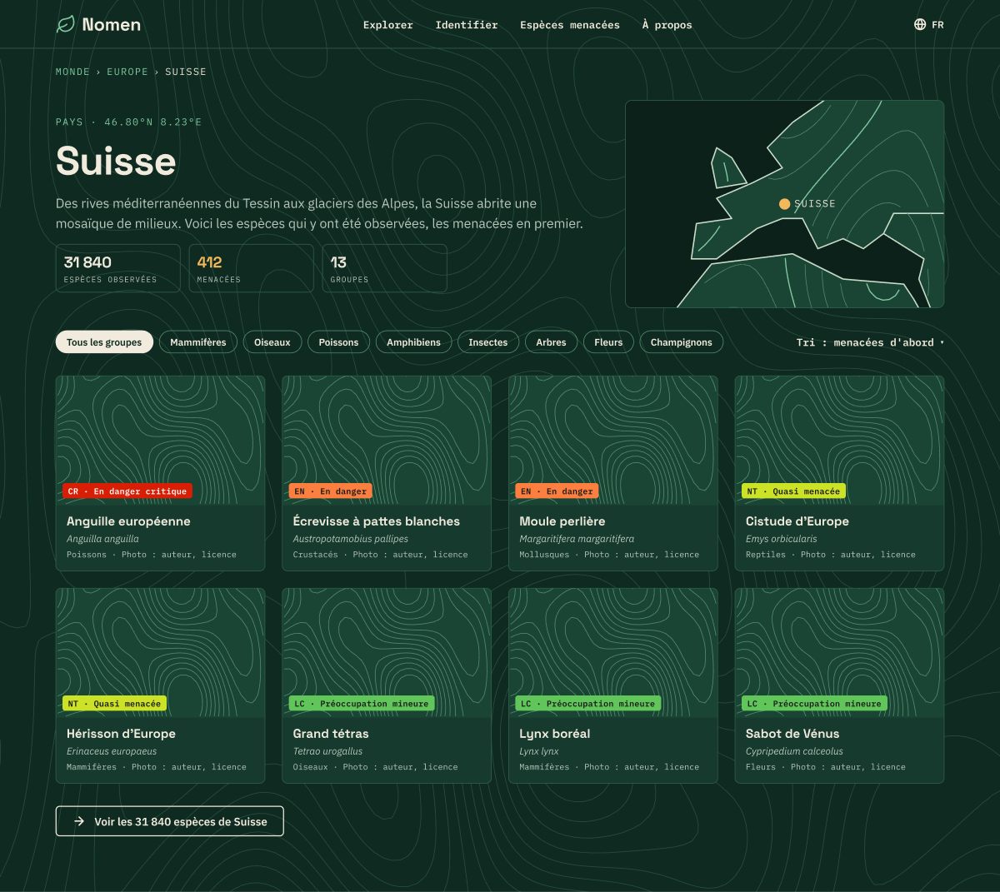
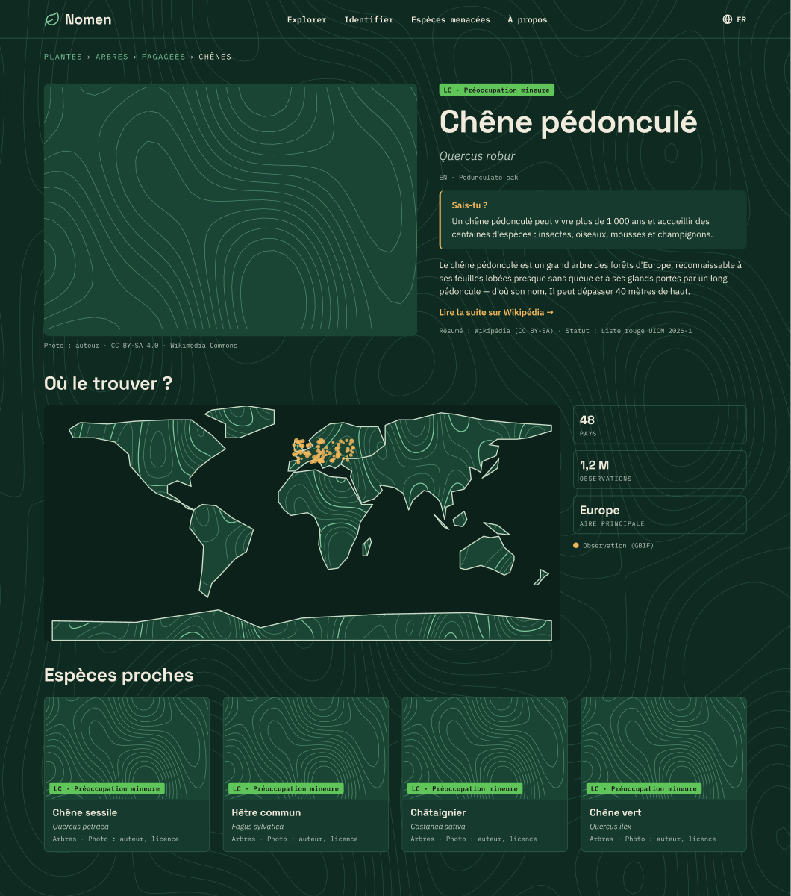
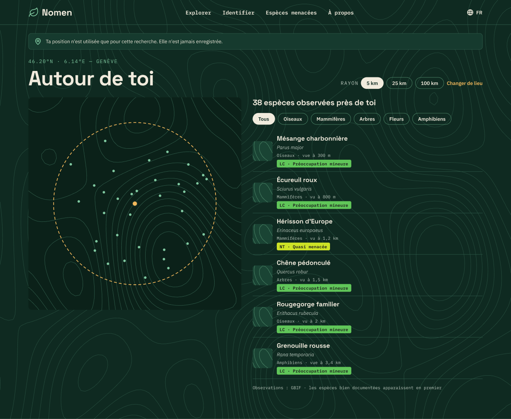

# Écrans clés

*Étape 3 — dessinés le 17 novembre 2026, en attente de validation. Fichier : [Figma « Nomen »](https://www.figma.com/design/lbR59tuBWRe62sapV6RSum/Nomen), page **Écrans clés** (ordinateur à gauche, téléphone à droite).*

Tous les écrans sont construits avec les composants du [design system](Design%20system.md) (en-tête, boutons, puces, cartes et lignes d'espèces, badges, statistiques) et suivent les [parcours validés](Parcours%20utilisateurs.md). Les chiffres et les espèces affichés sont des **exemples** ; les photos sont remplacées par des courbes de niveau en attendant les vraies.

| Écran | Parcours | Ce qu'on y voit |
|---|---|---|
| **Continent — Europe** | Explorer la carte | Carte zoomée sur l'Europe, panneau latéral : statistiques, choix du pays, onglets Toutes / Menacées / Par groupe, liste des espèces menacées. Sur téléphone : panneau qui monte du bas. |
| **Pays — Suisse** | Explorer la carte | Nom du pays, coordonnées, chiffres clés, petite carte de situation, filtres par groupe, grille d'espèces **menacées d'abord**. |
| **Fiche espèce — Chêne pédonculé** | Toutes les portes mènent ici | Photo créditée, badge de statut, nom courant, latin et anglais, encadré « Sais-tu ? », résumé Wikipédia avec lien, carte de répartition (points d'observation), chiffres, espèces proches, sources. |
| **Recherche — « boulot »** | Recherche | « Tu voulais dire *bouleau* ? » (tolérance aux fautes), filtres (groupe, statut, lieu), liste de résultats. |
| **Identifier une plante** | Identifier une plante | Ta photo, partie photographiée (feuille, fleur…), 3 propositions avec **jauge de confiance**, bouton vers la fiche, conseil si le résultat est incertain, mention de Pl@ntNet et de la limite quotidienne. |
| **Autour de moi** | Autour de moi | Bandeau de confidentialité, lieu et coordonnées, rayon 5 / 25 / 100 km, carte locale avec le cercle de recherche et les observations, liste des espèces proches avec la distance. |

## Aperçus

### Pays — Suisse

### Fiche espèce

### Autour de moi

## Composants ajoutés pour ces écrans

- **Ligne espèce** : vignette, nom, nom latin, information (groupe, distance, nombre d'observations), badge de statut.
- **Statistique** : un chiffre clé et son libellé (valeur en ambre pour les espèces menacées).

## Limites connues

- La carte est le dessin simplifié des maquettes : pas encore de frontières de pays (elles viendront de Natural Earth).
- Les états d'erreur (pas de connexion, limite Pl@ntNet atteinte, aucun résultat, géolocalisation refusée) sont décrits dans les parcours mais pas encore dessinés.
- Le vrai logo reste à créer.

## Suite

1. Valider ces écrans (ou demander des changements).
2. Dessiner les états d'erreur et les pages annexes (À propos, Sources et crédits) si besoin.
3. Fin de l'étape 3 → release, puis **étape 4 : choix de la stack technique** ensemble.

Voir aussi : [Style visuel](Style%20visuel.md) · [Design system](Design%20system.md)
