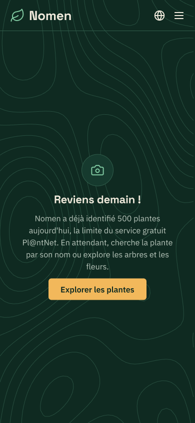
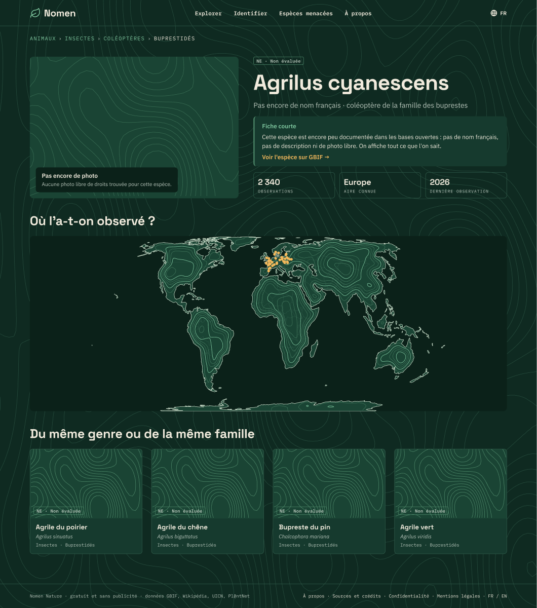

# Écrans secondaires

*Étape 3 — dessinés le 17 novembre 2026, en attente de validation. Fichier : [Figma « Nomen »](https://www.figma.com/design/lbR59tuBWRe62sapV6RSum/Nomen), page **Écrans secondaires**.*

Ils complètent les [écrans clés](Ecrans%20cles.md) pour couvrir toute la V1. Tous utilisent le [design system](Design%20system.md), dont deux nouveaux composants : **Message d'état** (erreurs et listes vides) et **Pied de page**. Les textes des pages légales sont des **brouillons à faire relire** avant la mise en ligne.

## Navigation et parcours

| Écran | Formats | Points clés |
|---|---|---|
| **Fiche peu documentée** (*Agrilus cyanescens*) | Ordinateur, téléphone | Le cas le plus fréquent : pas de nom français, pas de photo, statut **NE · Non évaluée**. Encadré « Fiche courte », chiffres, carte des observations, espèces du même genre, lien vers GBIF. |
| **Identifier une plante — choisir une photo** | Ordinateur, téléphone | Zone de dépôt, « Prendre une photo » / « Choisir une image », formats acceptés, conseils pour un bon résultat, mention de confidentialité. |
| **Liste d'un groupe** (Oiseaux) | Ordinateur, téléphone | Filtres lieu (Suisse / Europe / Monde) et statut, tri, grille d'espèces, « Afficher plus ». La page **Espèces menacées** reprend ce modèle avec le filtre « Menacées » activé. |
| **Menu** | Téléphone | Les 5 portes d'entrée, choix de la langue, liens annexes. |

## États d'erreur et cas limites (téléphone)

Tous construits avec le composant **Message d'état** : une icône, un titre, une explication chaleureuse et une action.

| État | Message | Action |
|---|---|---|
| Pas de connexion | « Nomen a besoin d'Internet… » | Réessayer |
| Aucun résultat | « Rien pour « chêne bleu »… essaie le nom latin » | Explorer par groupe |
| Limite Pl@ntNet atteinte | « Reviens demain ! » (500 identifications par jour) | Explorer les plantes |
| Plante non reconnue | « Essaie avec une photo plus nette… » | Reprendre une photo |
| Avant la demande de position | Explique pourquoi et que la position n'est jamais enregistrée | Partager ma position / Choisir un lieu |
| Position refusée | « Pas de souci ! Choisis un lieu… » | Choisir sur la carte + recherche de ville |
| Chargement | Blocs gris à la place du contenu (squelette) | — |
| Page introuvable (404) | « Ce sentier ne mène nulle part » — ordinateur et téléphone | Recherche, retour à la carte |

## Pages annexes

| Page | Formats | Contenu (brouillon) |
|---|---|---|
| **Politique de confidentialité** | Ordinateur, téléphone | En bref ; ta position ; tes photos ; statistiques sans cookies ; services utilisés ; tes droits (nLPD, RGPD). Sommaire à droite sur ordinateur. |
| **Sources et crédits** | Ordinateur | GBIF, Catalogue of Life, Wikipédia, photos (Commons, iNaturalist), UICN, Pl@ntNet, Natural Earth, polices et code. |
| **À propos** | Ordinateur | Pourquoi Nomen, comment ça marche, principes, qui fait Nomen. |
| **Mentions légales** | — | Même modèle de page ; contenu à rédiger (éditeur, hébergeur, licences). |

## Aperçu : fiche peu documentée

## Ajouts au design system

- **Message d'état** : titre, texte, icône, action facultative.
- **Pied de page** : ordinateur et téléphone.
- **Badge de statut** : ajout de **DD** (données insuffisantes) et **NE** (non évaluée).

## À compléter plus tard

- Les adresses de contact et l'hébergeur dans les pages légales (après le choix de la stack).
- Une relecture des textes légaux par une personne compétente.

Voir aussi : [Écrans clés](Ecrans%20cles.md) · [Checklist qualité](../Checklist%20qualite.md)
