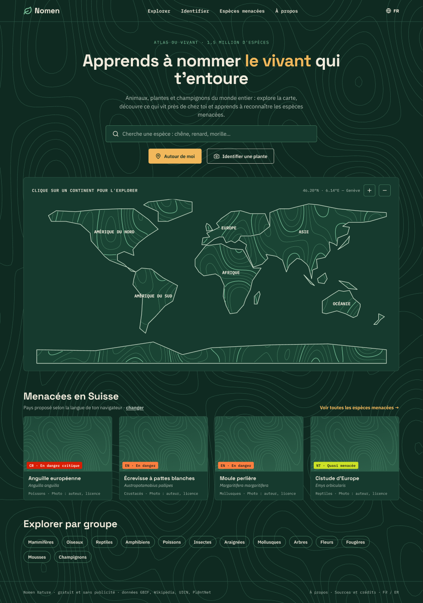
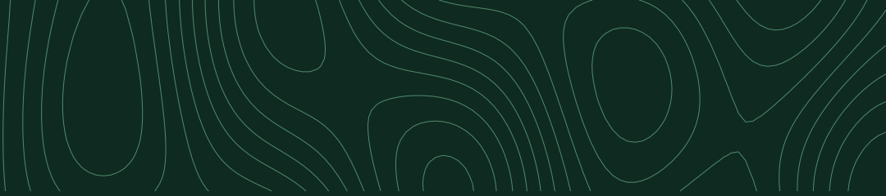
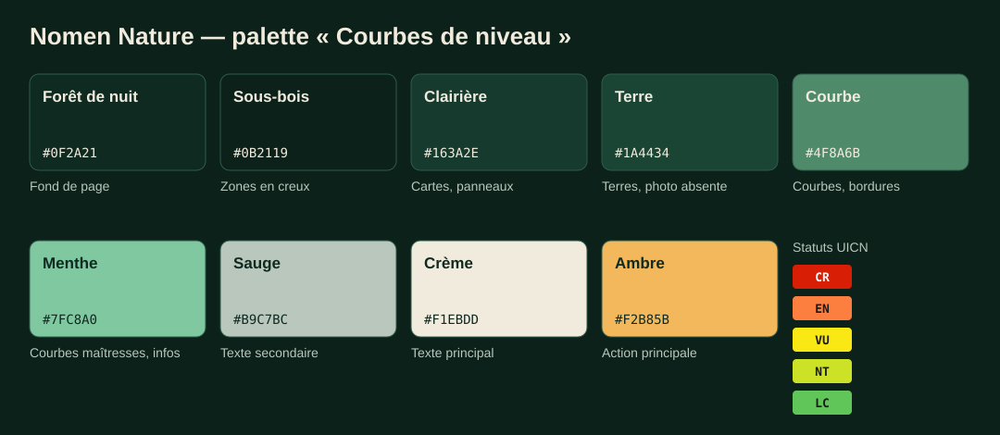
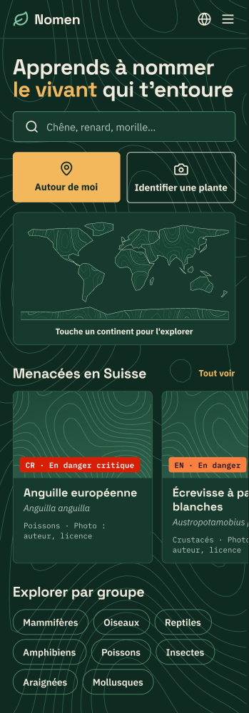

# Style visuel — « Courbes de niveau »

*Style retenu le 17 novembre 2026 (direction E d'origine). Valeurs exactes et composants : [Design system](Design%20system.md).*

## L'idée

Nomen Nature ressemble à **une carte topographique consultée de nuit**, à la lampe frontale : un fond vert forêt très sombre, des **courbes de niveau** fines qui couvrent la page et la carte, et quelques touches de lumière (crème, ambre, menthe).

Trois raisons à ce choix :

1. **On parle de terrain.** Les courbes de niveau évoquent tout de suite la randonnée, l'exploration, la carte qu'on lit dehors. C'est exactement l'esprit « découvre ce qui vit autour de toi ».
2. **Les courbes ont un sens.** Sur la carte, elles représentent la **richesse du vivant** : plus elles sont serrées, plus il y a d'espèces. Le style décore *et* informe.
3. **Ça ne ressemble à rien de générique.** Les premières pistes (verts doux, blanc, arrondis) avaient l'air de n'importe quelle application ; celle-ci a une identité.

## La palette

| Nom | Couleur | Rôle | Règle |
|---|---|---|---|
| **Forêt de nuit** | `#0F2A21` | Fond de page | Le fond par défaut, partout |
| **Sous-bois** | `#0B2119` | Zones en creux | Carte, barre latérale : un cran plus sombre que la page |
| **Clairière** | `#163A2E` | Cartes, panneaux, champs | Tout ce qui « flotte » au-dessus du fond |
| **Terre** | `#1A4434` | Terres sur la carte, photo absente | Remplit les continents |
| **Courbe** | `#4F8A6B` | Courbes de niveau, bordures | Toujours en trait fin (0,7 à 1,5 px) |
| **Menthe** | `#7FC8A0` | Courbes maîtresses, surtitres, coordonnées | L'information, jamais l'action |
| **Sauge** | `#B9C7BC` | Texte secondaire, noms latins | Pour ce qui se lit après le titre |
| **Crème** | `#F1EBDD` | Texte principal, traits de côte | Le blanc du site : jamais de blanc pur |
| **Ambre** | `#F2B85B` | Action principale, mot mis en avant | **Rare** : un seul bouton ambre par écran, plus le mot « le vivant » |

Les **statuts de menace** utilisent les couleurs officielles de l'UICN (CR rouge, EN orange, VU jaune, NT vert-jaune, LC vert), uniquement dans les badges, et toujours avec le code et le libellé écrits.

### Pourquoi ces couleurs fonctionnent

- **Lisibilité** : crème sur forêt de nuit = contraste 12,9:1 ; sauge = 8,7:1 ; texte sur ambre = 8,6:1. Bien au-delà du minimum WCAG AA (4,5:1).
- **Hiérarchie claire** : l'ambre attire l'œil vers l'action, la menthe signale l'information, le crème porte le contenu. Une couleur = un rôle.
- **Les photos ressortent** : sur un fond sombre et peu saturé, les photos d'animaux et de plantes deviennent les éléments les plus colorés de la page.

## La typographie

| Police | Rôle | Pourquoi |
|---|---|---|
| **Space Grotesk** (gras) | Titres, noms d'espèces, logo | Géométrique, un peu technique, très lisible en grand |
| **IBM Plex Sans** | Texte courant, boutons | Neutre et confortable à lire, italique élégant pour les noms latins |
| **IBM Plex Mono** | Navigation, surtitres, coordonnées, crédits, badges | Le côté « instrument de mesure » : comme les annotations d'une carte |

Le ton visuel suit le ton du texte : on **tutoie**, on reste chaleureux, mais la police à chasse fixe rappelle qu'il y a de vraies données derrière.

## Les motifs et détails

- **Courbes de niveau** : en fond de page (très discrètes), à l'intérieur des continents, et à la place des photos manquantes.
- **Coordonnées** en police technique (« 46.20°N · 6.14°E — Genève ») : petits rappels de géographie.
- **Surtitres** en capitales espacées et menthe (« ATLAS DU VIVANT · 1,5 MILLION D'ESPÈCES »).
- **Coins peu arrondis** (6 à 10 px) : sérieux sans être froid. Les puces sont en pilule.
- **Pas d'ombres** : la profondeur vient des nuances de vert (sous-bois → forêt → clairière).
- **Icônes au trait**, 2 px, jamais d'émojis.

## À faire / à éviter

| ✅ À faire | ❌ À éviter |
|---|---|
| Un seul bouton ambre par écran | Mettre de l'ambre partout : il perd sa force |
| Courbes fines et discrètes en fond | Des courbes épaisses ou trop contrastées qui gênent la lecture |
| Crème pour le texte | Du blanc pur (#FFFFFF) qui éblouit sur fond sombre |
| Badges de statut avec code + libellé | Indiquer une menace par la couleur seule |
| Photos créditées, en grand | Photos sans auteur ni licence |

## Sur téléphone

Mêmes couleurs, mêmes polices, tailles réduites (titre 34 px au lieu de 58). Les deux boutons principaux passent côte à côte sous la recherche, et les listes d'espèces défilent horizontalement.

Voir aussi : [Design system](Design%20system.md) · [Directions visuelles](Directions%20visuelles.md) (historique des pistes)
